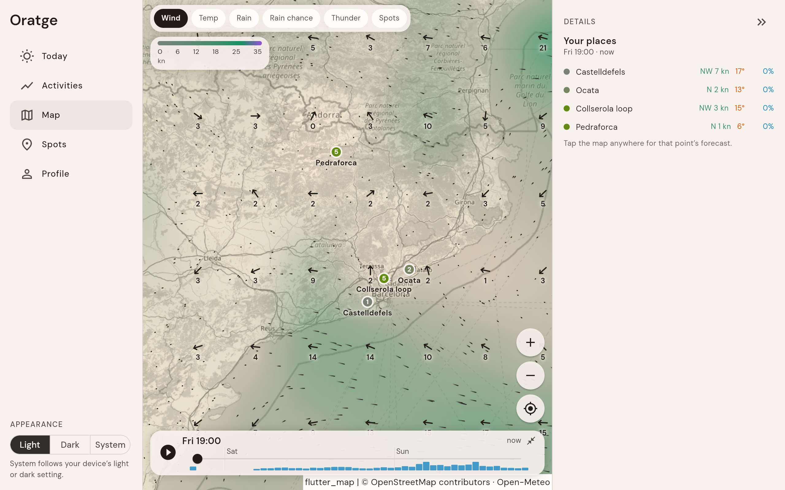
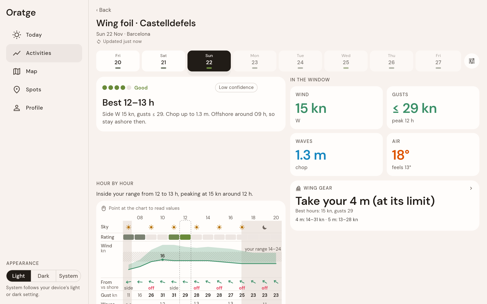
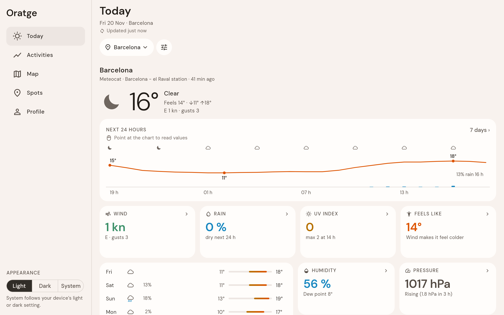
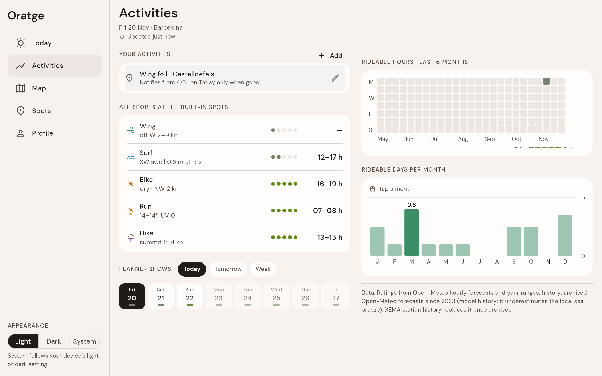

<!-- portfolio:date=2026-11-09 -->
# Oratge

**[English](README.md) · [Deutsch](README.de.md)**

<p align="center"></p>

Oratge ist ein Wetterplaner für Wingfoilen, Surfen, Radfahren, Laufen und Wandern in Katalonien. Die Flutter-App bewertet jede Prognosestunde pro Sportart über ein FastAPI-Backend, das Open-Meteo-Modelle mit Live-Stationsdaten von Meteocat kombiniert.

## Highlights
- **Bewertungs-Engine pro Sportart** — das Python-Backend bewertet jede Prognosestunde mit gewichteten Faktoren je Sportart (Wingfoil: Wind im eigenen Bereich, eigenes Material, Böenfaktor, Windrichtung zur Küste, Kabbelwasser, Regen, Tageslicht), wählt das beste Zeitfenster und leitet aus der Streuung des ECMWF-Ensembles eine Konfidenz ab.
- **Datenschicht mit Kontingentsteuerung** — der kostenlose Meteocat-Plan erlaubt 100 Prognose-, 750 Stations- und 250 Blitzabfragen pro Monat; ein SQLite-Ledger teilt das Restkontingent in Tagesanteile auf, gleicht es mit dem offiziellen Verbrauchszähler von Meteocat ab und liefert die letzte gecachte Antwort, sobald der Tagesanteil verbraucht ist.
- **Wetterkarte nach Sichtbereich** — sobald die Karte stillsteht, lädt die App ein Gitter für den sichtbaren Ausschnitt (0,25° nah, bis 3° weit herausgezoomt, höchstens 360 Punkte) und zeichnet Wind-, Temperatur-, Regen- und Gewitterfelder mit begrenzter Catmull-Rom-Interpolation, animierten Windpartikeln und einer 48-Stunden-Zeitleiste.
- **Aktivitäten und GPX-Routen** — eigene Spots erhalten ihre Küstenausrichtung aus Geländehöhen; GPX-Tracks werden vereinfacht, etwa alle 2 km abgetastet und je Sportart zeitlich eingeplant (Rad und Lauf mit Zuschlag pro Höhenmeter, Wandern nach Naismith), um das Wetter entlang der Route zu bewerten.
- **Offline-tolerante App** — Stale-while-revalidate-Cache (Speicher und Festplatte), 6 s Timeout und 45 s Back-off halten die Screens auch bei schlechter Verbindung schnell; mitgelieferte Beispieldaten dienen als letzte Rückfallebene.
- **Wing-Materialrechner** — Faustregeln für Wing-Größe und Windbereich, in Python und Dart umgesetzt und über gemeinsame Referenz-Testfälle synchron gehalten.
- **Geräteübergreifende Synchronisierung und Benachrichtigungen** — Profil, Aktivitäten und Favoriten werden über das Backend synchronisiert (Last-Writer-Wins pro Schlüssel); Android prüft stündlich im Hintergrund (WorkManager) mit Schwellen pro Sportart, Ruhezeiten und Duplikatfilter.
- **CI/CD** — GitHub Actions führt die Backend-Tests aus, baut das Image, pusht es nach GHCR und deployt über einen signierten Webhook; ein zweiter Workflow baut die macOS-App als DMG.

## Screenshots
<p align="center">
   
</p>
<p align="center">
  
</p>

## Architektur
```
Flutter-App (Android · macOS · Web)
  │  JSON über HTTPS, Bearer-Token
  ▼
FastAPI-Backend ──► Open-Meteo: Prognose, Marine, ECMWF-Ensemble, Modellvergleich, archivierte Prognosen, Geocoding
  │             └─► Meteocat (SMC): XEMA-Stationswerte, amtliche Warnungen, Blitze, Strand- und Gipfelprognosen
  ▼
SQLite: Antwort-Cache · Kontingent-Ledger · Prognose-/Beobachtungsarchiv · Sync-Speicher
```
- **Backend** (`backend/oratge/`): `sources.py` lädt und cacht Daten und setzt das Meteocat-Kontingent durch; `engine.py` macht aus Stundenwerten Bewertungen und Zeitfenster pro Sportart; `build.py` erzeugt die Antworten für die Screens (`/v1/today`, `/v1/planner/{sport}`, `/v1/map/forecast`, …); `activities.py` prüft eigene Spots und GPX-Routen; `archive.py` speichert Prognosen und Messwerte für den Abgleich Prognose vs. Station.
- **App** (`app/lib/`): `data/` enthält Repository mit Cache und Rückfallebene, Modelle, Profil und Sync; `ui/` die Screens, CustomPainter-Diagramme und die Kartenebenen (`ui/map/`).
- **Design**: `design/` und `design-system/` enthalten die Design-Übergabe und Komponentenreferenz, nach der die App gebaut wurde; `docs/` die API-Analyse, Architekturnotizen und den Abgleich Design vs. Daten.

## Tech-Stack
Flutter · Dart · flutter_map · WorkManager · Python · FastAPI · httpx · SQLite · Docker · GitHub Actions · Open-Meteo · Meteocat API

## Ausführen
**App** (benötigt das Flutter SDK; ohne Backend läuft sie mit mitgelieferten Beispieldaten):
```bash
cd app
flutter pub get
flutter run                                    # Android-Gerät/Emulator, macOS oder Chrome
flutter run --dart-define=ORATGE_API=https://dein-backend --dart-define=ORATGE_TOKEN=…   # mit Backend
```
Backend-Adresse und Token lassen sich auch in der App unter „Profile → Sync and server“ eintragen.

**Backend** (Python 3.12 oder `backend/Dockerfile`):
```bash
cd backend
pip install -r requirements.txt pytest
pytest                                         # Tests
ORATGE_TOKEN=… METEOCAT_API_KEY=… uvicorn oratge.api:app --port 8000
```
Ohne `METEOCAT_API_KEY` läuft das Backend nur mit Open-Meteo.

## Datenquellen
Prognosen von [Open-Meteo](https://open-meteo.com) (CC BY 4.0). Stationswerte, Warnungen und Blitze vom Servei Meteorològic de Catalunya (SMC / Meteocat). Kartenkacheln © OpenStreetMap-Mitwirkende.
