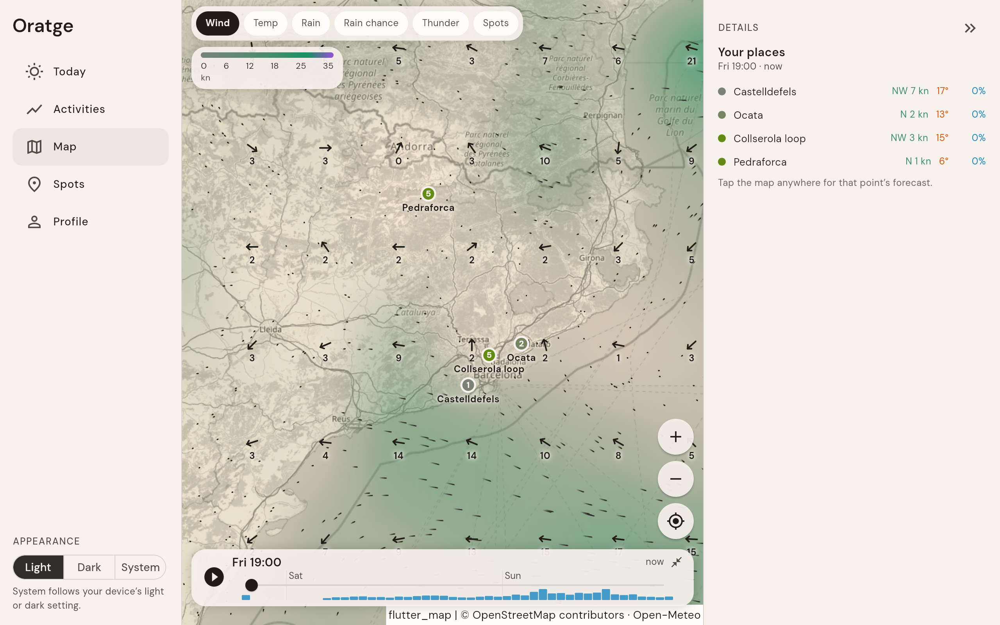
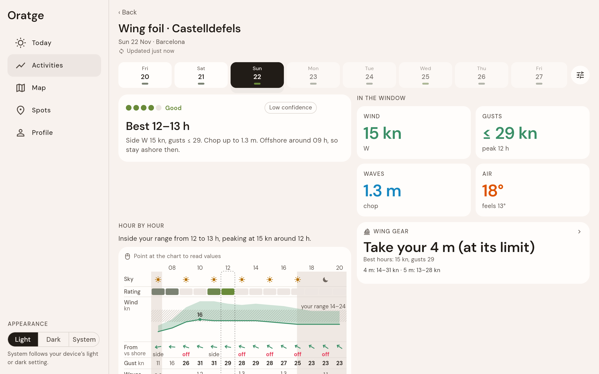
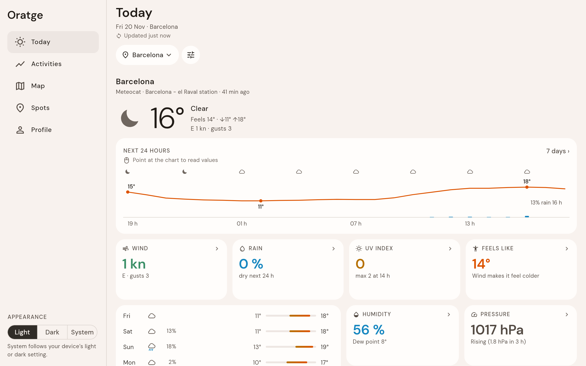
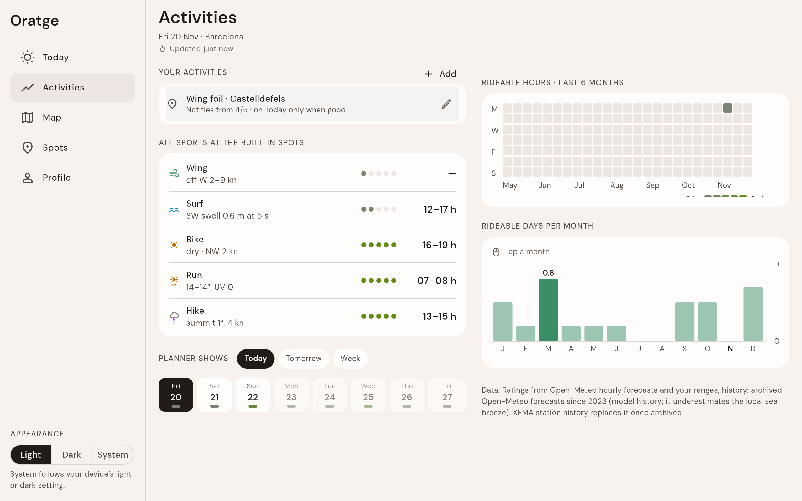

<!-- portfolio:date=2026-11-09 -->
# Oratge

**[English](README.md) · [Deutsch](README.de.md)**

<p align="center"></p>

Oratge is a weather planner for wing foiling, surfing, cycling, running and hiking in Catalonia. A Flutter app rates every forecast hour per sport, using a FastAPI backend that merges Open-Meteo models with live Meteocat station data.

## Highlights
- **Per-sport rating engine** — the Python backend scores every forecast hour with weighted factors per sport (wing foil: wind in your range, your gear, gust factor, wind direction against the shore, chop, rain, daylight), picks the best window and derives a confidence level from the ECMWF ensemble spread.
- **Quota-governed data layer** — Meteocat's free plan allows 100 forecast, 750 station and 250 lightning calls a month; a SQLite ledger splits what is left into a daily share, reconciles it with Meteocat's own usage counter and serves the last cached answer once the share is spent.
- **Viewport-driven weather map** — after the camera settles, the app requests a grid for the visible area (0.25° up close, up to 3° zoomed out, at most 360 points) and renders wind, temperature, rain and thunder fields with clamped Catmull-Rom interpolation, animated wind particles and a 48-hour timeline.
- **Activities and GPX routes** — custom spots get their shore orientation from terrain elevation; GPX tracks are simplified, resampled about every 2 km and timed by sport (cycling and running add time per metre climbed, hiking uses a Naismith-style pace) to rate the weather along the route.
- **Offline-tolerant client** — a stale-while-revalidate cache (in memory and on disk), a 6 s timeout and a 45 s back-off keep screens fast on a bad connection, with bundled sample data as the last fallback.
- **Wing gear calculator** — rules of thumb for wing size and wind range, implemented in both Python and Dart and kept in step by shared reference test cases.
- **Cross-device sync and notifications** — profile, activities and favourites sync through the backend with per-key last-writer-wins; Android checks hourly in the background (WorkManager) with per-sport thresholds, quiet hours and de-duplication.
- **CI/CD** — GitHub Actions runs the backend tests, builds the image, pushes it to GHCR and redeploys through a signed webhook; a second workflow builds the macOS app as a DMG.

## Screenshots
<p align="center">
   
</p>
<p align="center">
  
</p>

## Architecture
```
Flutter app (Android · macOS · web)
  │  JSON over HTTPS, bearer token
  ▼
FastAPI backend ──► Open-Meteo: forecast, marine, ECMWF ensemble, model comparison, archived forecasts, geocoding
  │             └─► Meteocat (SMC): XEMA live station readings, official warnings, lightning, beach and summit forecasts
  ▼
SQLite: response cache · quota ledger · forecast/observation archive · sync store
```
- **Backend** (`backend/oratge/`): `sources.py` fetches and caches data and enforces the Meteocat quota; `engine.py` turns hourly data into per-sport ratings and windows; `build.py` assembles the screen payloads (`/v1/today`, `/v1/planner/{sport}`, `/v1/map/forecast`, …); `activities.py` checks custom spots and GPX routes; `archive.py` stores forecasts and observations for the forecast-vs-station check.
- **App** (`app/lib/`): `data/` holds the repository with caching and fallback, models, profile and sync; `ui/` holds the screens, CustomPainter charts and the map layers (`ui/map/`).
- **Design**: `design/` and `design-system/` contain the design handoff and component reference the app was built from; `docs/` has the API analysis, architecture notes and the design-to-data check.

## Tech stack
Flutter · Dart · flutter_map · WorkManager · Python · FastAPI · httpx · SQLite · Docker · GitHub Actions · Open-Meteo · Meteocat API

## Running it
**App** (needs the Flutter SDK; without a backend it runs on bundled sample data):
```bash
cd app
flutter pub get
flutter run                                    # Android device/emulator, macOS or Chrome
flutter run --dart-define=ORATGE_API=https://your-backend --dart-define=ORATGE_TOKEN=…   # with a backend
```
The backend address and token can also be set in the app under Profile → Sync and server.

**Backend** (Python 3.12, or the `backend/Dockerfile`):
```bash
cd backend
pip install -r requirements.txt pytest
pytest                                         # tests
ORATGE_TOKEN=… METEOCAT_API_KEY=… uvicorn oratge.api:app --port 8000
```
Without `METEOCAT_API_KEY` the backend runs on Open-Meteo alone.

## Data sources
Forecasts from [Open-Meteo](https://open-meteo.com) (CC BY 4.0). Station readings, warnings and lightning from the Servei Meteorològic de Catalunya (SMC / Meteocat). Map tiles © OpenStreetMap contributors.
